# SmartBoardOS 🖊️

**A complete interactive smart-board operating system that runs in the browser — now a full teachers' hub.**
Built for teachers — whiteboard with **pen pressure & palm rejection**, PDF presentations, **3D teaching models**, a **safe class browser that sends anything to the board**, class tools, widgets and PDF export. Works offline, installs as a PWA, and deploys on GitHub Pages with zero build steps.

<p align="center">
  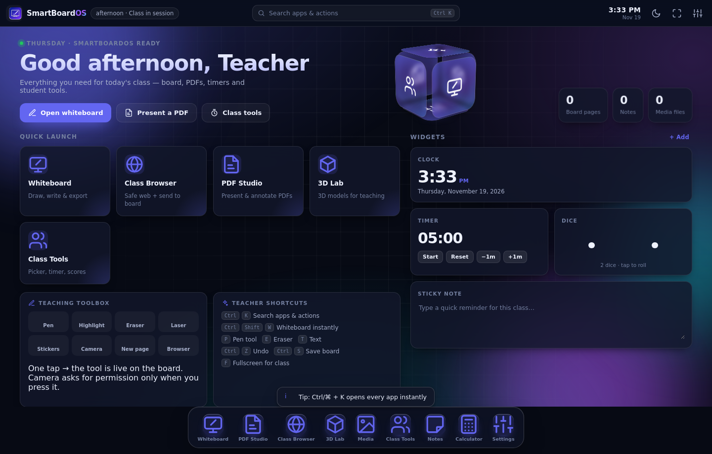
</p>

---

## ✨ What's inside

SmartBoardOS is not a single whiteboard page — it is a small **desktop OS in the browser**: a top bar with a live clock, a dock, a window manager with draggable and resizable windows, widgets, a command palette, and 9 built-in apps that all share your data.

| App | What it does |
| --- | --- |
| 🖊️ **Whiteboard** | Pen with **real pressure & tilt**, **software palm rejection** for any stylus, **select / move / resize / duplicate** any item, floating toolbox, emoji **stickers**, page manager with thumbnails, **web cards from the browser**, camera → board, highlighter, eraser, shapes, text, laser, pinch-zoom, 6 backgrounds (grid, dots, lines, **ruled paper**, **music staves**), undo–redo, autosave, PNG & multi-page **PDF export** |
| 🌐 **Class Browser** | Safe search (adult content blocked, SafeSearch forced), 16 curated classroom sites, **Reader mode** with clean text + images, and one-tap **Send to board** (link card, article, picture) |
| 🧊 **3D Lab** | 14 interactive 3D models (cube, cuboid, sphere, cylinder, cone, prism, pyramid, torus, icosahedron + solar system, H₂O, CO₂, CH₄, DNA helix). Orbit, zoom, auto-spin, wireframe, floor grid, teaching notes, **snapshot → whiteboard** and PNG download |
| 📄 **PDF Studio** | Open any PDF (drag & drop or file picker), thumbnails sidebar, page navigation, zoom, rotate, recent files kept on device, **any page can be sent to the whiteboard as an annotation layer** |
| 🖼️ **Media** | Image library stored on your device (IndexedDB), drag & drop upload, send any image straight to the board, download or delete |
| 🎓 **Class Tools** | Random student picker with confetti, spinning name wheel, class timer with chime, stopwatch with laps, team scoreboard, dice roller |
| 📝 **Notes** | Autosaving lesson notes with a sidebar, search-free quick access, Markdown export |
| 🧮 **Calculator** | Keyboard-friendly calculator with live expression preview |
| 📷 **Camera** | Built into the board and Settings — take a photo of a worksheet and it lands straight on the board (permission is asked only when you press it) |
| ⚙️ **Settings** | Dark / light theme, 5 accent colours, 4 wallpapers, animations toggle, 12/24-hour clock, teacher name, **pen / palm / pressure panel**, camera test, JSON backup, full data reset, install button |

### Home screen & widgets
- Greeting hero with class stats, quick-launch cards, keyboard-shortcut cheat sheet
- **Widgets**: live clock, quick timer with chime, sticky note, dice — add or remove any of them
- **Command palette** (`Ctrl/⌘ + K`) to open any app or run any action

### 🖊️ Pen, tablet & palm rejection
- **Every pen works** — Wacom, Huion, XP-Pen, Apple Pencil, S Pen, USI pens and touch-laptop digitizers all raise standard pointer events, so pressure (`pressure`), tilt (`tiltX/Y`) and contact size are read directly. No drivers, no plugins.
- **Pressure-aware strokes** — line width follows how hard you press, and the highlighter widens when the pen is tilted.
- **Software palm rejection** — the board ignores anything that is *not* a pen while you write: large contacts (a resting hand), any touch for a moment after the pen lifts (adjustable 0–2000 ms), and it can be set to **Strong** or **Off**. This is what devices *without* native palm rejection need.
- **Finger drawing** stays available for touch laptops and phones — toggle it off for pen-only writing.
- **Floating toolbox** — a draggable toolbar that stays on the canvas while you present (pen, highlighter, eraser, laser, text, stickers, undo, pages). Switch it on with the ✨ button.
- Settings → **Pen, tablet & palm** stores every preference on the device and applies it instantly.

### 🖱️ Move anything on the board
- New **Select** tool (`S`): tap any stroke, shape, text, image, sticker or web card to select it — a dashed box with a corner handle appears
- **Drag to move**, pull the corner handle to **scale** it (strokes and shapes scale their geometry too), `Delete` to remove, `Ctrl/⌘ + D` to duplicate, `Esc` to deselect
- Every move is undoable, and moving an item still respects autosave

### 🎨 Board pages, paper & stickers
- **Page manager** with live **thumbnails** — jump, duplicate a layout, delete, or add a page with the same background
- **6 backgrounds** — grid, dots, vertical lines, **ruled notebook paper** (with margin), and **music staves**, per page
- **80 bundled emoji stickers** (Twemoji art, drawn as vectors, identical on every device and in PDF exports)
- **Web cards** — pages sent from the Class Browser become tappable cards on the board; tap one to reopen it in the browser
- Drop a link or an image from any browser window onto the canvas and it becomes a card or an image

### 🌐 Class Browser — safe, and connected to the board
- **Adult content is blocked** twice: a local keyword/domain filter (always on) plus forced SafeSearch on every engine we hand off to (`safe=active`, `adlt=strict`, `kp=1`)
- **Class search** uses Wikipedia's API — real, reviewed results that open in **Reader mode**: clean text, no ads, plus the page's pictures
- **Send to board, live** — send the page as a **link card**, the article **text**, or any **picture**; the board opens with it placed in the middle and the card reopens the page later
- 16 curated safe starting points (Wikipedia, Khan Academy, PhET, GeoGebra, Desmos, NASA, CK-12, OpenStax, NCERT, Scratch, Smithsonian…)
- Sites that refuse to be embedded fall back gracefully: Reader mode or open in a tab
- Everything is filtered on-device — browsing history and bookmarks never leave your machine

### 🍎 macOS-style window controls
Traffic-light buttons (red / yellow / green) show their **glyph only on hover or keyboard focus** — exactly like macOS — so the title bar stays clean but every action is still discoverable.

### 3D depth & motion
- **3D Lab** powered by Three.js (r160, bundled locally — works offline) with orbit controls built from scratch: drag to rotate, wheel / pinch to zoom, aspect-aware framing so models fit on phones too
- **Hero 3D cube** on the home screen, five visible faces showing your apps
- **Tilt-on-hover** cards with a moving light gloss, **parallax** glowing background that follows your pointer, and a **3D-lifted dock**
- **Windows open in depth** (rotateX + translateZ) and tilt while you drag them
- Every effect respects the *Animations* setting in Settings and `prefers-reduced-motion`

### System features
- **Window manager** — drag, resize from any edge, minimise to dock, maximise, focus stacking, mobile full-window mode
- **Fully responsive** — desktop, tablet and phone layouts; pointer + touch drawing with pinch zoom
- **Animations everywhere** — boot sequence, window transitions, widget stagger, confetti, toast notifications (respects reduced-motion)
- **PWA** — installable, offline-first service worker, app shortcuts (`?app=whiteboard`, `?app=browser`, `?app=pdf`, `?app=class`, `?app=lab3d`)
- **Autosave** — the board, notes, names, teams and settings are restored when you come back
- **Privacy first** — every PDF, image and note stays on your device. No servers, no uploads, no accounts.

<p align="center">
  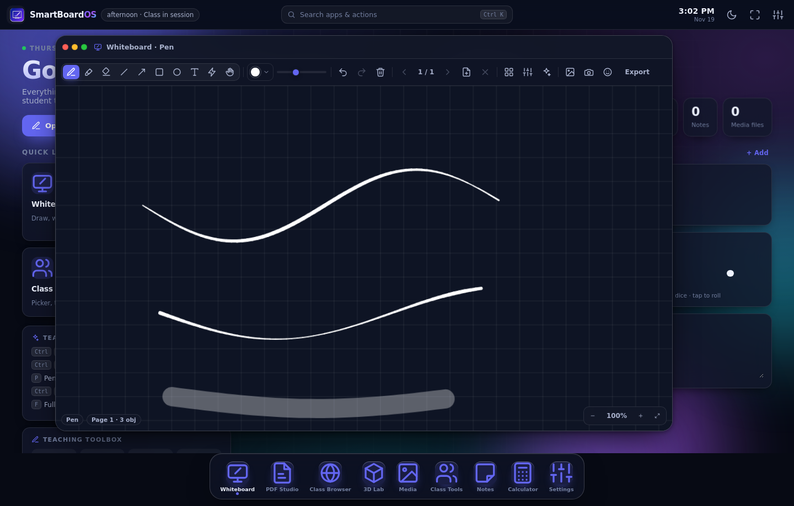
</p>

### 🧊 3D Lab

<p align="center">
  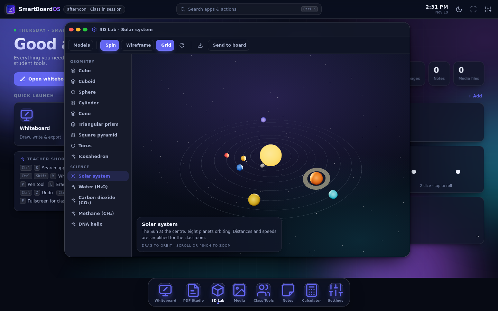
</p>

<p align="center">
  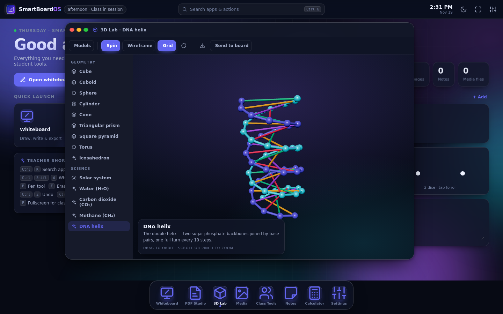
  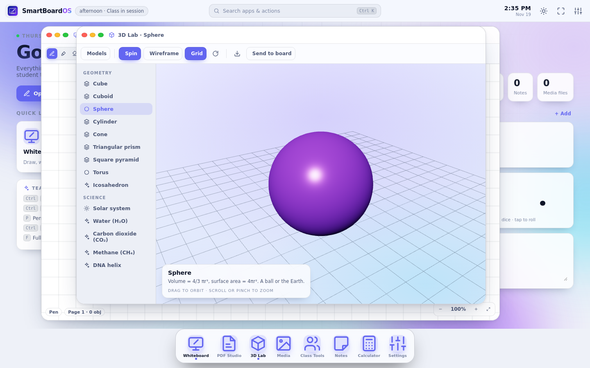
</p>

<p align="center">
  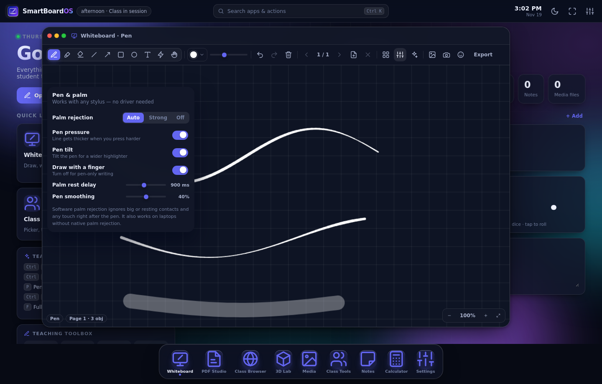
</p>

<p align="center">
  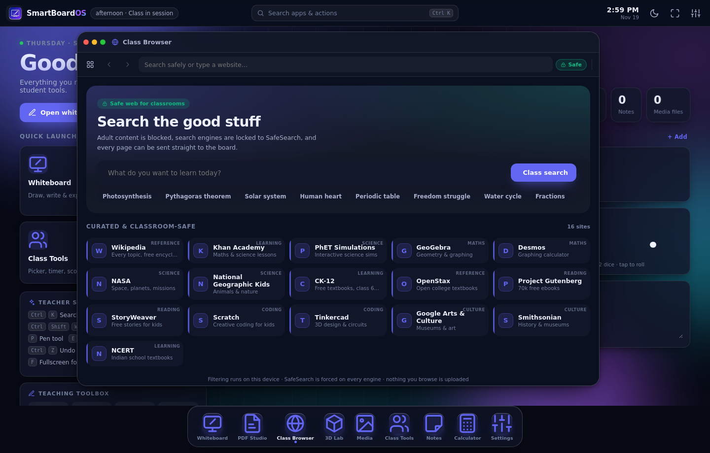
</p>

<p align="center">
  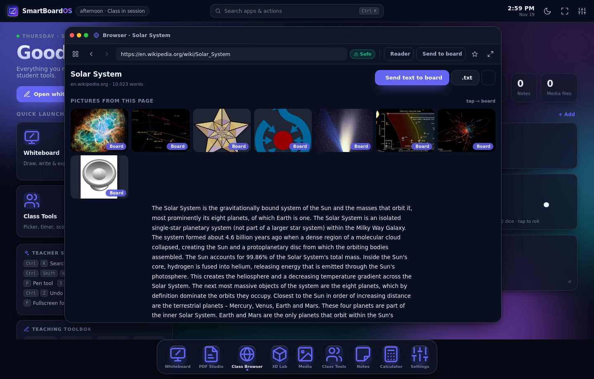
</p>

<p align="center">
  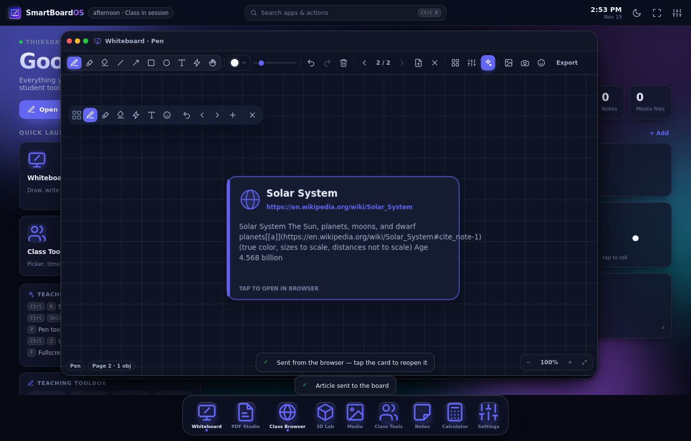
</p>

<p align="center">
  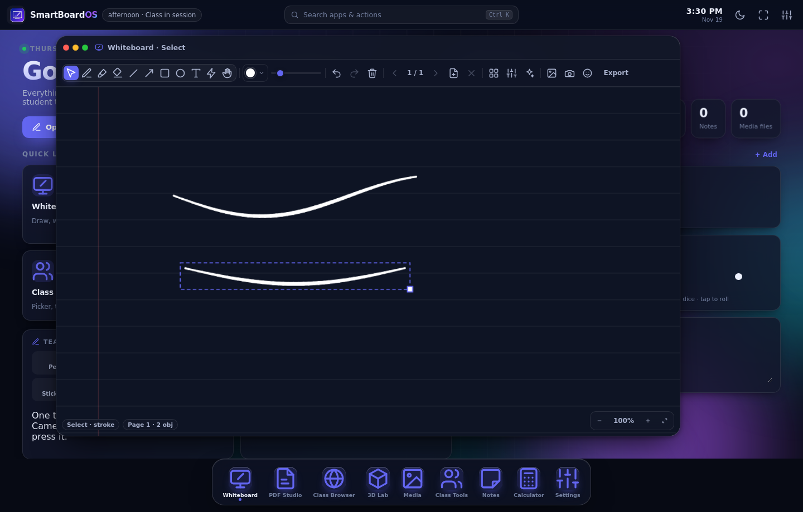
</p>

<p align="center">
  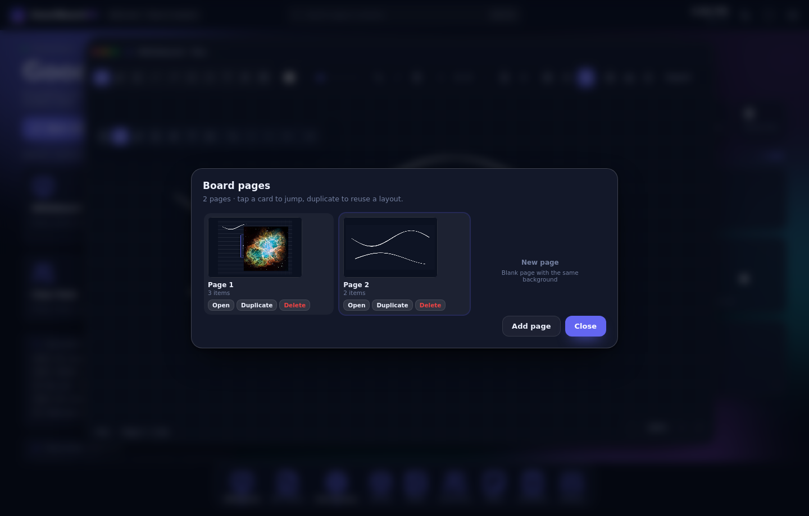
  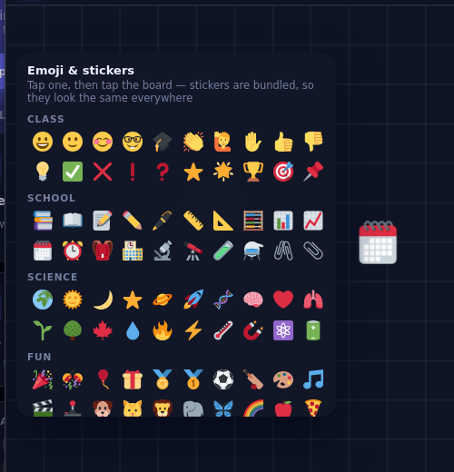
</p>

<p align="center">
  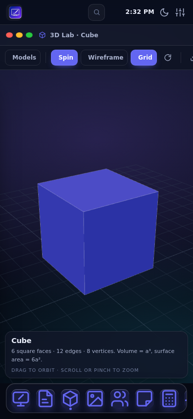
  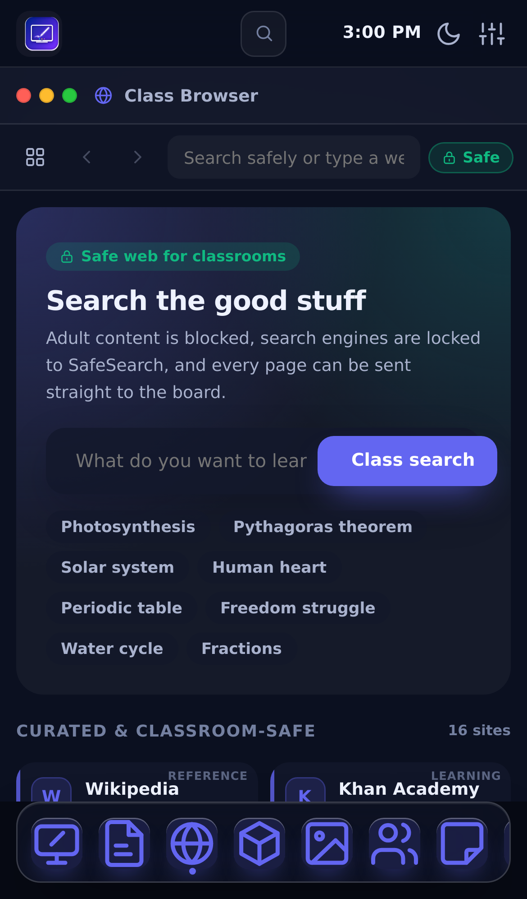
  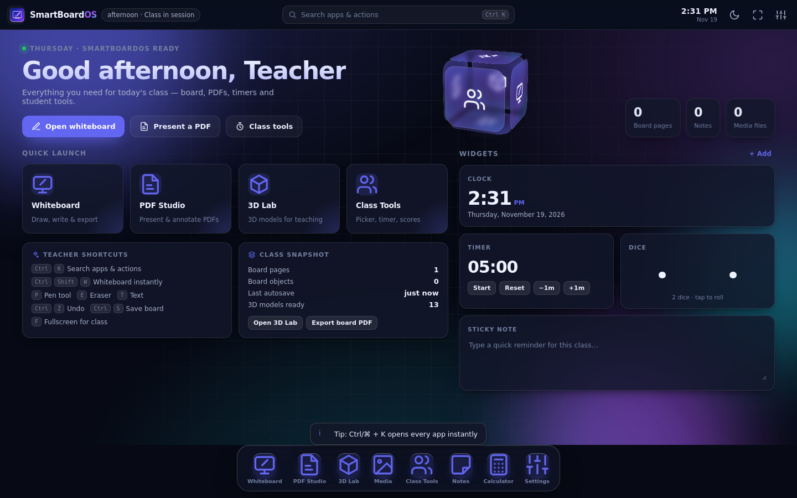
</p>

Annotate a 3D model in class: rotate it to the angle you want, hit **Send to board**, and write over the snapshot on the whiteboard — or download it as a PNG for your worksheet.

---

## 🚀 Go live on GitHub Pages (2 minutes)

> Sabse aasan rasta (Hinglish, 3 options): **[`UPLOAD-TO-GITHUB.md`](UPLOAD-TO-GITHUB.md)**
> One-shot script: `./scripts/publish.sh <github-username>`

> **Hinglish quick start:** repo banane ke baad sirf neeche wale 3 commands chalao, phir GitHub → **Settings → Pages → Source: GitHub Actions**. Bas! Aapki site live ho jayegi:
> `https://<your-username>.github.io/smartboardOS/`

### Option A — with the GitHub CLI (`gh`)

```bash
cd smartboardOS
gh repo create smartboardOS --public --source=. --remote=origin --push
```

### Option B — plain git

```bash
cd smartboardOS
git init -b main
git add .
git commit -m "feat: SmartBoardOS v1.0.0"
git remote add origin https://github.com/<your-username>/smartboardOS.git
git push -u origin main
```

### Then enable Pages

1. Open the repo → **Settings → Pages**
2. Under **Build and deployment → Source**, choose **GitHub Actions**
3. The included workflow (`.github/workflows/deploy.yml`) publishes the site on every push to `main`

Your app is live at `https://<your-username>.github.io/smartboardOS/`
(Push to `main` again to update it — no build step, no npm install.)

> Using a custom domain or a user site (`<user>.github.io`)? Everything uses relative URLs, so it works at any path.

---

## 🧑‍🏫 Run it locally

```bash
# any static server works
npx serve .
# or
python3 -m http.server 5173
```

Then open <http://localhost:5173>.
(Don't open `index.html` with `file://` — service workers and ES modules need `http`.)

---

## ⌨️ Keyboard shortcuts

| Shortcut | Action |
| --- | --- |
| `Ctrl/⌘ + K` | Command palette (apps + actions) |
| `Ctrl/⌘ + Shift + W` | Open whiteboard |
| `Ctrl/⌘ + Shift + P` | Open PDF Studio |
| `Ctrl/⌘ + Shift + T` | Open Class Tools |
| `F` | Fullscreen (great for the classroom projector) |
| `S` `P` `H` `E` `L` `A` `R` `O` `T` `Z` `V` | Select · Pen · Highlighter · Eraser · Line · Arrow · Rect · Ellipse · Text · Laser · Pan (inside the board) |
| `Delete` / `Ctrl/⌘ + D` / `Esc` | Delete · duplicate · deselect the selected board item |
| `Ctrl/⌘ + Z` / `Ctrl/⌘ + Shift + Z` | Undo / redo (board) |
| `Ctrl/⌘ + S` | Save board |
| `[` / `]` | Brush size down / up |
| `Ctrl + wheel` / pinch | Zoom the board |
| `←` `→` | Page navigation in PDF Studio |

---

## 🗂 Project structure

```
smartboardOS/
├── index.html                 # OS shell: boot screen, top bar, desktop, dock, palette
├── manifest.webmanifest       # PWA manifest (icons, shortcuts, standalone display)
├── sw.js                      # Offline-first service worker
├── css/styles.css             # Design system: themes, accents, windows, apps, responsive
├── js/
│   ├── main.js                # Bootstrap: app registry, dock, palette, PWA, shortcuts
│   ├── wm.js                  # Window manager (drag / resize / minimise / maximise)
│   ├── widgets.js             # Desktop widgets
│   ├── db.js                  # localStorage + IndexedDB persistence
│   ├── utils.js               # Helpers (toasts, confetti, files, sounds)
│   ├── icons.js               # Inline SVG icon set
│   ├── diceface.js            # CSS dice faces
│   ├── pen.js                 # Pen / pressure / tilt + software palm rejection
│   ├── camera.js              # Camera sheet (photo → board)
│   ├── safeweb.js             # Adult-content filter, SafeSearch, reader, class search
│   ├── emoji-data.js          # 80 bundled Twemoji stickers (data URIs, offline)
│   └── apps/
│       ├── whiteboard.js      # Canvas board: pressure strokes, pages, stickers, cards
│       ├── browser.js         # Safe class browser + send-to-board bridge
│       ├── lab3d.js           # 3D Lab — Three.js models, orbit controls, snapshots
│       ├── pdf.js             # PDF.js viewer + send page to board
│       ├── media.js           # On-device image library
│       ├── class.js           # Picker, wheel, timer, stopwatch, scoreboard, dice
│       ├── notes.js           # Lesson notes
│       ├── calculator.js
│       └── settings.js
├── vendor/                    # pdf.js + jsPDF + three.js bundled locally (works offline)
├── assets/icons/              # App icons (192 / 512 / maskable / apple-touch)
├── docs/                      # Screenshots used in this README
└── .github/workflows/deploy.yml
```

No framework, no bundler, no `node_modules` — pure ES modules and Canvas.

---

## 💾 Where is my data?

| Data | Stored in |
| --- | --- |
| Board pages (strokes, shapes, images) | IndexedDB → `boards` |
| Uploaded images | IndexedDB → `media` |
| Recent PDFs | IndexedDB → `docs` |
| Notes, student names, teams, settings | localStorage (`sbos:*`) |

Everything is local to the browser profile. Use **Settings → Data → Export everything** for a JSON backup of your board + notes, or **Reset** to wipe everything.

---

## 🛠 Tech

Pointer Events API for pen pressure / tilt / contact size, Canvas 2D, Three.js r160, PDF.js 3.11, jsPDF 2.5, IndexedDB, a hand-written service worker. Emoji stickers use [Twemoji](https://github.com/jdecked/twemoji) graphics (CC-BY 4.0).

- Vanilla JavaScript (ES modules), Canvas 2D, CSS custom properties
- [Three.js](https://threejs.org/) r160 — 3D models, lighting and rendering (bundled, 655 KB, lazy-loaded)
- [pdf.js](https://mozilla.github.io/pdf.js/) 3.11 — PDF rendering (bundled)
- [jsPDF](https://github.com/parallax/jsPDF) 2.5 — PDF export (bundled)
- Service worker + Web App Manifest for offline/installable behaviour
- Pointer Events for mouse, touch and stylus input

### Updating a deployed copy
Bump `VERSION` in `sw.js` (and `VERSION` in `js/main.js`) when you change files, commit and push. Current release: **v1.3.0** (`sbos-v1.3.0`). The workflow redeploys and the service worker swaps the cache.

---

## 🗺 Roadmap ideas

- [ ] Real-time collaboration between teacher devices (WebRTC)
- [ ] Handwriting → text recognition on the board
- [ ] Board page templates (graph paper, music staves, lined)
- [ ] Handwriting to text (on-device OCR)
- [ ] Camera-driven gesture control for presentations
- [ ] Quiz mode with student response grid
- [ ] Export notes + board into a single lesson PDF

---

## 📄 License

MIT © SmartBoardOS contributors — free to use in classrooms, schools and coaching institutes.
